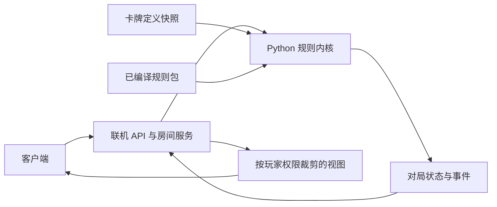

# 雷霆之石游戏规则引擎设计（草案 v0.4）

本文定义独立 TypeScript 包中负责**规则配置校验、组局、判定合法行动和计算对局结果**的规则内核。Python 后端通过适配层调用它。联机层负责房间、玩家列表、配置收集和全员准备，再将冻结配置及有序玩家列表提交给引擎；引擎返回结算结果后，联机层使房间回到闲置。交接契约见[引擎边界](game-engine/00-engine-boundary.md)，逐章的实现约定见[详细设计目录](game-engine/README.md)。原始参考规则 JSON 是设计草案，运行时使用独立的已绑定规则包。

**2026-10-22 实现进度**：当前经典规则的 setup、回合、战斗、计分、场景与全部效果卡已建立可执行绑定和逐卡测试。520 张有效果的卡牌均为 `COMPLETE`，包含 446 条可执行能力与 227 条持续机制绑定，其他词条由基础数值、设置和系统规则覆盖。[实现说明](game-engine/ability-runtime-implementation.md)记录具体语义及用户裁定，[效果实验台](game-engine/effect-lab.md)提供执行轨迹与全卡覆盖清单。联机层、正式客户端和合作／单人变体仍是后续阶段；下文保留设计及原始资料的背景说明。

## 1. 参考资料与现状

| 资料 | 内容 | 在工程中的用途 |
| --- | --- | --- |
| [`cards/cards.csv`](../cards/cards.csv) 与 [数据字典](data-model.md) | 722 条卡牌定义，包含编号、分类、中文卡面文字、静态数值和正式图片路径 | 卡牌定义和展示内容的正式来源 |
| [`thunderstone_card_atoms_v0.3.2_author_reviewed.xlsx`](游戏引擎设计参考/thunderstone_card_atoms_v0.3.2_author_reviewed.xlsx) | 12 个工作表：逐卡与逐能力汇总、原子词典、控制流与选择器、历史回溯、8 项人工裁定、系统规则、测试场景等 | 人工审阅记录和规则语义说明，不作为运行时输入 |
| [`thunderstone_card_rules_v0.3.2_engine.json`](游戏引擎设计参考/thunderstone_card_rules_v0.3.2_engine.json) | 722 张牌、964 条能力的触发信息、条件、目标查询、效果原子和 AST 草案；另有 1 条系统规则、8 项裁定、10 个测试案例 | 待编译的规则设计输入，不作为可直接执行的脚本 |
| [`TS4_rules_CN.pdf`](../game_TTS/TS4_rules_CN.pdf) | 《飞龙尖塔》中文规则书：标准对局设置、三种回合行动、战斗、地下城特征、终局及可选变体 | 标准对局基础流程的主要依据；具体卡牌和其他扩展仍可能覆盖通则 |
| [`TDS_CN.json`](../game_TTS/TDS_CN.json) | TTS 模组初始物件、牌堆和 Lua 脚本 | 核对现有模组的组局与抽牌操作；物件 GUID、坐标和帧等待不进入规则内核 |

工作簿与 JSON 均把规则拆成“触发 → 条件 → 目标/选择 → 控制流 → 业务效果”。目前词典含 46 种触发、78 种条件、85 种效果原子、19 种控制节点、10 种选择器。521 张牌有规则正文，共拆出 964 条能力；其中 2 条仅引用系统通用规则，不应作为卡牌效果重复执行。

卡牌原子表和规则 JSON 解决了能力的**分类和语义拆解**；规则书补上了标准对局的基础流程。JSON 的 `implementation_maturity` 明确标为 `AST_DESIGN_DRAFT_NOT_DIRECTLY_EXECUTABLE`：799 条能力仍是通用模板，具体目标、条件作用域、数量或时序尚需绑定；另外 163 条有不同程度的逐卡结构化草案。`is_executable_as_card_ability=true` 只表示该能力应由卡牌结算，并不表示 AST 已通过编译和测试。工作簿也注明未对全部 964 条能力逐字核对英文。

规则适用顺序：采用选定游戏模式的基础规则；当具体卡牌明确覆盖通则时，以该卡为准（规则书第 20 页）。TTS 自动化脚本可用于核对既有实现，但不是裁定卡牌效果的独立规则来源。第一阶段以规则书中的**标准竞争对局**为目标；合作与单人变体分别作为规则配置扩展，不混进标准流程。

### 现有数据差异

- JSON 的 722 个 `id` 都能与 CSV 的 `card_id` 对上；名称、标签、二级分类以及 13 项已比对静态数值也一致。
- JSON 内 722 条 `assets.image_path` 全部仍指向旧的 `generated/cards/...`；运行时应使用 CSV 的 `image_path`。
- JSON 的 `TS-0717`、`TS-0718` `source_text` 已按人工裁定改为“仅提示系统规则”的表述，CSV 的 `effect_text` 仍是旧文本。引擎采用已确认的系统规则语义；玩家显示文本继续取 CSV，待单独校正卡面/CSV 时再同步，不在导入过程中暗改。
- 公共牌背 `TS-BACK-001` 在 JSON 中的 `type` 为“空白”，CSV 的 `card_type` 为空；它不是可玩牌，导入时按 `slot_kind=back` 排除。
- 工作簿说明页把 AST 位置写作 `cards[].semantic_abilities[].atomization_v03.body`，但当前 JSON 实际位置是 `cards[].abilities[].ast`。导入器须以实际 schema 校验，不能照说明页的旧路径取值。

## 2. 设计边界

规则内核是一个不依赖 HTTP、数据库、TTS 或前端的 TypeScript 包。它先校验联机层交付的冻结配置与有序玩家列表，再生成对局；之后给定状态、玩家指令和随机数状态，产生新状态、事件、下一步合法操作或待选择项，并在终局计算结果。联网、身份验证、房间管理、玩家列表、准备、持久化和消息推送由外层联机服务负责。



每局固定 `catalog_version` 与 `ruleset_version`，进行中的对局不随卡牌目录或规则包更新而改变。图片、英文原图路径、审核状态不参与规则计算。各卡组默认实例数已从 TTS 初始牌堆一次性导入 `cards.csv.initial_copy_count`；本局对村庄牌、所有等级英雄牌、怪物牌分别设置 ×1～×5 倍率。联网后端运行时读取从 CSV 导入 SQLite 的目录快照，不查询 TTS，也不把全存档的 `tts_copy_count` 当供应数量。初始牌组等规则设置单独定义。

## 3. 核心数据模型

| 对象 | 必要信息 | 约束 |
| --- | --- | --- |
| `CardDefinition` | `card_id`、类型、标签、系列、卡面静态数值、能力 ID | 从 CSV 构建，只读；空数值与 `0` 严格区分 |
| `AbilityDefinition` | 能力 ID、来源卡牌、触发、有效区域、已编译条件/目标/效果树、来源文本与规则版本 | 只接受通过参数和语义校验的规则；保留回溯来源 |
| `CardInstance` | 唯一实例 ID、`card_id`、所属者、当前区域、临时状态 | 一种牌定义可在牌库、手牌和供应堆中有多个实例；战斗中待摧毁须单独标记 |
| `PlayerState` | 抽牌堆、手牌、弃牌堆、控制区、经验点和回合资源 | 手牌展示由当前回合上下文记录，不另建一份牌区；经验点跨回合保留，金币等回合资源按规则清零；隐藏信息仅经授权视图对外暴露 |
| `StartGameRequest` / `Match` | 有序玩家列表、冻结规则配置、目录/规则版本；每局的规则状态与结果 | 联机层提供请求并保证同房间至多一局活动对局；规则内核校验后组局 |
| `GameState` | 玩家、回合及当前行动、村庄供应、地下城牌堆与大厅、场景/环境、疾病牌堆、摧毁区、玩家控制的宝藏、随机状态、结算栈、待选择项、版本号 | 可序列化、可校验；所有实体牌实例应恰好处于一个区域，疾病可由供应规则生成；终局快照交给结算阶段 |
| `PendingChoice` | 选择者、候选实例/选项、数量边界、继续结算所需上下文 | 必须能跨请求保存，其他玩家不能代选 |
| `Modifier` / `Trigger` / `ScheduledEffect` | 来源、作用对象、有效期限、事件时机、优先级依据 | 离开有效区域或期限结束时正确失效 |

经验值在规则层使用 `upgrade_xp_cost` 与 `defeat_xp_reward` 两个有明确含义的字段；不直接使用歧义较大的 `wiki_经验值`。卡面印刷数值、当前修正值和最终战斗合计要分开：例如 `正文_基础攻击` 只是导入线索，不能代替装备、光照、怪物特性结算后的攻击力。

联机层管理房间配置与全员准备。引擎从冻结请求开始，依次经历配置校验、`SETTING_UP`、`PLAYING`、`SETTLING` 和 `COMPLETED`。回合内部再有开始前/开始后、选择行动、村庄效果/金币/购买/升级、地下城准备/宣告目标/战斗/凯旋/大厅补位、休整、结束前/结束后等时点；具体事件名称见[回合流程](game-engine/04-turn-flow.md)。

## 4. 标准对局的基础规则

以下是《飞龙尖塔》规则书中的标准流程，作为基础规则模块的输入。特殊环境、其他扩展和具体卡面可以改变这些步骤；引擎应把改变写成有来源的设置或替代规则，而不是修改通用流程中的常量。

### 4.1 组局与牌堆（规则书第 2～4 页）

- 分别维护怪物、英雄、村庄随机设置牌池。规则书的默认组局目标是 **3 组怪物**、**4 组英雄**、**8 组村庄牌**；抽怪物随机设置牌时遇到的地下城特征不计入怪物组数，但须保留并逐项结算。网页版可在规则设定阶段修改目标数量、指定部分或全部组，剩余名额由随机设置牌补足；随机设置牌完成设置后不进入实际对局区域。
- 怪物组组成地下城牌堆；陷阱和宝藏组洗入牌堆，守护者按规则加入底部区域，场景/环境至多生效一张。普通设置把所选雷霆之石与地下城牌堆底部 10 张牌洗混。`TS-0199`“放逐仪式”等卡会覆盖这种放置方式和终局条件。
- 地下城大厅有阶层 1～3，阶层 1 离牌堆最远。开局翻出的陷阱、宝藏先置于地下城牌堆底部并补牌；设置期间不触发突破效果。
- 村庄始终放置四种基础牌。英雄供应堆按等级从低到高露出，常见配置为 1 级 6 张、2 级 4 张、3 级 2 张，但特殊英雄可不同。购买只能取堆顶；升级按对应系列寻找下一等级牌。村庄牌也按选中的种类分别建堆。
- 每名玩家以 **6 民兵、2 匕首、2 应急干粮、2 火把**组成 12 张初始牌库，洗牌并抽 6 张。首位玩家默认随机，也可由联机层指定玩家、上一局唯一赢家或参赛房主；随后按固定玩家列表顺序轮转。`SetupCatalog` 主要由 CSV 的分类、名称、英雄系列和怪物标签生成，加入色彩龙、名称别名等少量例外；各成员默认张数从 CSV 的 `initial_copy_count` 读取，村庄、英雄、怪物牌按本局类别倍率实例化。

TTS 模组的 Lua 脚本也按 3 组怪物、4 组英雄、8 组村庄牌选择，并给入座玩家发上述 12 张初始牌；它还处理地下城特征、特殊疾病牌堆，以及“放逐仪式”对应的雷霆之石和“末日之心”摆放。脚本中的 TTS `CardID` 可通过 CSV 的 `tts_card_id` 追溯到正式 `card_id`，但物件 GUID、坐标与异步 `Wait.frames` 只是桌面操作细节。脚本没有自动判定完整回合和战斗，网页实现仍需按规则书建立权威状态机。

特殊疾病牌堆的组局条件在现有资产中有三处：怪物随机牌 `TS-0034`“腐化德鲁伊”、`TS-0035`“虫群”，以及英雄随机牌 `TS-0148`“希德”。TTS 脚本按三组已选牌堆切换疾病牌堆；网页版应由正式卡牌 ID 的设置规则决定，不能只检查希德。

### 4.2 回合与村庄（规则书第 5～9、24 页）

玩家每回合必须在**访问村庄、进入地下城、休整**中选一种，按所选行动的步骤顺序结算。每次行动结束，弃掉仍在手牌/展示区的牌，抽 6 张新手牌。抽牌堆不足时先抽完，再洗混弃牌堆并继续抽；弃牌堆在需要抽牌且抽牌堆耗尽前不得洗混。获得的牌进入弃牌堆，摧毁的普通牌进入摧毁区；被摧毁的疾病则回到疾病供应堆。

| 村庄子阶段 | 规则要求 |
| --- | --- |
| 展示与能力 | 展示手牌，自选村庄能力的使用与顺序；强制能力必须执行。每张牌上的单个能力每回合至多使用一次，标明“重复”的能力例外。已经在此阶段摧毁的牌不能继续提供能力或金币。 |
| 计算金币 | 只合计此时仍在场的已展示卡牌金币值，加上能力产生的金币。 |
| 购买 | 默认购买 1 张牌，从供应堆顶部取，费用不超过可用金币；获得牌进入弃牌堆。额外购买由能力授予，所有购买共用本次金币总额，未用金币回合结束时消失。 |
| 升级 | 购买之后，可用持有的经验点升级手牌中任意数量的英雄：支付该英雄的 `upgrade_xp_cost`、摧毁原牌、从本局已选英雄系列供应堆取**下一等级**牌放入弃牌堆。同一张牌不能连续升级或跳级；目标等级无库存则不能升级。民兵可花费 3 点经验升级为本局任一可用 1 级英雄。 |

休整只允许摧毁手牌中的至多 1 张牌，然后进入回合清理；村庄与地下城能力不会因为休整而可用。

### 4.3 地下城准备与战斗（规则书第 5、10～16、24 页）

1. 展示全部手牌，结算强制效果，并由玩家依规则选择是否及按何顺序使用可选地下城效果。已获得的战利品在手牌中展示时必须使用其战利品效果；同一怪物仍在大厅时不产生这些收益。每名英雄通常最多装备 1 件武器，每件武器只能装备一次，且重量不得超过该英雄当前力量；未装备的武器不提供收益。法术、物品和战利品可以不依附英雄而生效。
2. 准备完成后必须宣告大厅中的 **1 个**攻击目标，即使预计无法击败。守护者位于阶层 0 时也可被选为目标。不能攻击的英雄不贡献受限制的攻击或其他收益，但仍可能被战斗效果指定。
3. 分开计算普通攻击和魔法攻击，逐项应用疾病、装备、免疫、限制与其他修正，再执行翻倍/减半等最终修正。单项攻击修正可以为负；疾病惩罚须分配给当时至少有 `+1` 的合法攻击类型。随后计算光照惩罚：一般阶层的基础惩罚为阶层数，阶层 0 为 0；加入怪物/环境修正、扣除有效光照后不低于 0，每剩余 1 点使最终攻击减少 2。光照过量不会提高攻击，光照惩罚也不会把最终攻击压到 0 以下。具体卡面可覆盖通则。
4. 目标怪物的战斗效果无论胜负都要结算；战斗中获得的疾病直接进入弃牌堆，不影响本次战斗。准备阶段被能力摧毁的牌立即离场；**战斗效果**要求摧毁的牌标记为战斗结束后移除，在本次战斗中仍有效。力量降低导致武器不再合法时，武器收益立即失效；英雄在战斗中力量曾降至 0 时，还要保留回合末待摧毁标记。
5. 所有效果处理后，按当前有效攻击和怪物生命值判断胜负。达到或超过生命值则击败：怪物进入玩家弃牌堆、玩家获得 `defeat_xp_reward`，再结算凯旋效果。失败的怪物通常回到地下城牌堆底部；“必须被击败才会离开”的怪物和守护者是例外。战斗中的待摧毁牌按其延迟时点移除。

`BattleContext` 至少记录目标怪物实例及原阶层、参战/不能攻击的英雄、武器分配、各来源的普通/魔法攻击与光照、已使用能力、临时修正、战斗后待摧毁牌、获胜结果。这样才能在效果改变力量、装备或大厅位置后重新计算，而不把一次性合计误存为基础属性。

### 4.4 大厅、地下城特征与终局（规则书第 9～10、17～20 页）

- 大厅里的怪物离开时，高阶层依次向低阶层补位，再从地下城牌堆补阶层 3。移动到阶层 1 的怪物触发一次突破；开局就位于阶层 1 的怪物不触发。大厅中怪物的全局效果持续生效，怪物被玩家获得并进入手牌后则按战利品/手牌效果处理，不能继续触发大厅中的战斗、突破或全局效果。
- 补牌翻出陷阱时立即结算，再继续补牌；翻出宝藏时由当前玩家取得，放入其控制区而非弃牌堆，之后可按卡面使用。连续翻出的陷阱/宝藏必须逐张处理，直到大厅填满合法的怪物或雷霆之石。结算顺序中，陷阱先于由补位导致的突破（规则书第 24 页）。
- 守护者到达阶层 1 时进入阶层 0；那里可有多名守护者，其持续效果影响所有玩家。阶层 0 战斗没有光照惩罚；守护者通常不能因未被击败而离场或改变位置。有守护者在阶层 0 时不能取得雷霆之石，但雷霆之石到达阶层 1 仍会结束游戏。
- 标准游戏在雷霆之石进入阶层 1 时**立即触发终局**，从对局阶段进入结算阶段，不再进行普通回合清理。若当前玩家击败阶层 1 怪物而使它进入该阶层，且没有阶层 0 守护者阻止取得，当前玩家取得雷霆之石；其他原因导致进入则无人取得。引擎按终局快照中玩家抽牌堆、手牌、弃牌堆和其他受其控制的卡牌计算胜利点；同分时持有雷霆之石者优先，否则共享胜利。联机层保存并发布结果后使房间回到闲置。环境牌等特殊规则可更改终局事件与胜负条件。

合作模式与单人变体在规则书第 22～23 页另有组局数量、共享经验、怪物推进和胜负条件；应使用独立 `ruleset_profile`，初版不把这些规则并入标准竞争对局。

## 5. 指令、事件与结算

客户端只提交意图，例如选择本回合行动、发动某能力、选择目标、装备武器、购买卡牌、攻击指定怪物或结束阶段。客户端不得提交“攻击合计为 12”“抽到某张牌”等计算结果。内核先检查指令是否在当前状态的 `legal_actions` 中，再由规则产生结果。

```python
def apply_command(
    state: GameState,
    command: Command,
    catalog: CardCatalog,
    rules: CompiledRuleset,
) -> Transition:
    """验证指令，返回新状态、公开/私有事件和可能的待选择项。"""
```

一次结算建议按以下概念步骤进行；确切的同事件优先级须由基础规则和逐卡裁定补全。

1. 核验当前玩家、阶段、资源、目标和状态版本。
2. 形成待处理事件，先应用合法的替代/阻止规则，再判定触发条件。
3. 按确定的顺序执行效果树；选择或并列裁决时生成 `PendingChoice`，保存可继续的结算帧。
4. 对实际状态变化继续派生事件，直到结算栈清空；记录随机抽取结果与来源。
5. 检查区域、资源、胜负和待处理选择等不变量，提交新状态与事件。

`COST_GATE` 必须先确认能够支付代价，再产生收益；玩家明确选择不发动时不支付。需要后续选择的效果可暂停并恢复，但每条玩家指令的状态提交必须原子化。`REPEAT_UNTIL` 除目标达成外还要有明确的“没有可执行下一步”终止条件，避免陷阱无限循环。`REGISTER_TRIGGER`、`SCHEDULE`、`REPLACE_EVENT` 与普通立即效果分开处理，防止事件递归或同一效果重复触发；事件日志应包含来源能力、目标和实际变化。

通用规则与卡牌提醒必须去重。例如 `BASE_STRENGTH_ZERO_DESTRUCTION` 在战斗期间检测英雄力量 `<= 0`，立即留下持续到回合末的待摧毁标记，力量恢复也不清除；回合末每名已标记英雄只摧毁一次。`TS-0717-A02`、`TS-0718-A02` 的 `RULE_REFERENCE` 只指向这条规则，不再各生成一次摧毁事件。

## 6. 规则数据编译，而非直接解释草案

首版运行时加载**已编译且通过验证的规则包**。编译流程建议如下：

1. 读取 CSV，按 `card_id` 建立卡牌定义；只把 `slot_kind=front` 放入可玩卡池。
2. 读取 JSON，核验 `schema_version`、ID 唯一性、引用的卡牌/原子/控制节点是否存在，并生成与 CSV 的差异报告。
3. 把 `trigger`、`conditions`、`target_queries` 和 `ast` 整合为有类型的能力定义。`flow_nodes`/`effect_atom_ids` 是审计线索，必须与 AST 的实际语义核对，不能作为执行逻辑的替代品。
4. 把 `amount_hint`、`source_excerpt` 之类的提取提示替换为确定的数量表达式、目标范围、持续时长和选择权。缺少必要参数就标记为**未编译**，不得猜测默认值。
5. 为每条可用能力生成至少一个正常场景，以及必要的边界场景；测试通过后才允许其进入指定牌池。无法编译的牌在组局前报告，不允许对局中默默忽略效果。

例如 `TS-0428-A02` 已明确为“摧毁手中 1 张疾病后抽 2 张”的可选代价效果，适合首先验证 `CHOICE` 与 `COST_GATE`。同卡 `TS-0428-A03` 的草案虽然列出 `COUNT_RESULT`，当前 AST 却只写了“抽 2 张”，没有绑定“每有 1 张怪物牌”的倍数；此类模板必须补全后才能运行。

规则词典提供可复用的运算类型，但具体牌的目标和来源仍应落在逐卡数据中。优先使用受限、可校验的数据表达式与注册过的 Python 原子处理器；不执行来自 JSON/CSV 的任意 Python 代码或文本 `eval`。少数难以用通用节点表达的卡牌可通过显式注册的专用处理器实现，保留能力 ID 和测试。

## 7. 异地多人联机所需的内核契约

- 同一对局的指令按 `game_version` 顺序处理。请求包含 `command_id`，重复提交返回已有结果，过期版本要求客户端刷新。
- 状态中保存随机数种子/状态；洗牌、随机抽取和随机选目标的实际结果写入事件记录。相同规则版本、初始状态和指令序列应能重放得到相同结果。
- 后端保存完整状态和事件；给每位玩家生成独立视图。选择村庄或地下城并按规则展示手牌后，本次已展示的牌成为公开信息；展示之前的手牌、休整时未展示的手牌、未公开牌库顺序和仅本人可见的选择候选不能随公共事件发送。
- 服务器在等待 `PendingChoice` 时持久化结算帧。断线重连后给有权选择的玩家恢复候选，其他人只看到可公开的等待状态。
- 规则包版本与对局快照一并持久化。数据库选择和 API 框架属于外层服务决策，不改变纯规则内核的输入输出契约。

## 8. 实施顺序与验收

1. **基础规则规范**：把第 4 节按规则书页码转成明确的阶段转换、合法行动、资源变化和边界测试；针对特殊环境与其他扩展建立可覆盖通则的规则配置。
2. **数据导入与校验**：TTS 初始供应数量已一次性导入 `cards.csv`；实现 CSV/规则 JSON 加载器、按分类/标签生成 `SetupCatalog` 的规则与小型例外表、三类倍率校验、差异报告、版本化快照和能力编译状态清单。正常构建不改写 `cards.csv`。
3. **最小可玩规则切片**：从无复杂触发的基础牌及少量村庄牌、英雄牌、怪物牌开始，贯通一次完整回合和结算。组局时只允许已编译、已测试的牌池。
4. **复杂能力**：依次加入被动修正、选择与支付、事件触发/替代、持续与延迟效果、陷阱循环、设置牌和动态胜利点。
5. **联机接入**：给内核加持久化适配器与 API，验证版本冲突、断线恢复、私有视图和重放。

首批回归案例直接采用 JSON 的 10 个 `tests_v032` 场景，包括零力量延迟摧毁、恶疫/疲惫去重、陷阱持续翻牌、死亡哨卫目标和希德开局配置。另需把规则书第 2～5、9～20、24 页的关键流程做成测试：组局数量与底部雷霆之石、每位玩家 12 张初始牌和 6 张手牌、村庄购买后升级、抽牌堆耗尽才洗弃牌堆、光照每点扣 2 攻击、准备阶段与战斗阶段的不同摧毁时点、连续陷阱/宝藏、守护者阶层 0、终局取得雷霆之石与同分裁决。再覆盖空牌堆、资源不足、重复指令、非法目标、随机重放及隐藏信息。每个获准进入牌池的能力都应有明确的编译状态和可复现测试；不能用“964 条已原子化”替代可运行覆盖率。

## 9. 后续需逐项裁定的规则边界

下列规则边界已在当前经典实现中绑定并测试，后续扩展仍需按同样方式记录来源和裁定：

- 自动生成的随机设置牌映射需审计的少量例外（例如色彩龙、村庄名称差异、多成员组）及特殊英雄结构；`cards.csv.initial_copy_count` 提供默认张数，其他桌面物件和全存档计数不得误入供应。
- 多个卡牌效果在同一时点发生时的选择者、先后顺序和替代效果链，尤其是持续全局效果、战斗后待摧毁牌、凯旋与大厅补位之间的交互。
- 特殊环境和扩展对标准设置、疾病牌堆、守护者、雷霆之石位置、动态胜利点与终局条件的覆盖范围，例如“放逐仪式”。
- 合作及单人模式仍待单独确定产品范围与规则；它们有独立的组局、资源共享和终局规则。

本设计以规则书的标准流程为基线。尚未有逐卡裁定的交互不得用 TTS 摆放方式或 AST 提取提示猜测结果。
