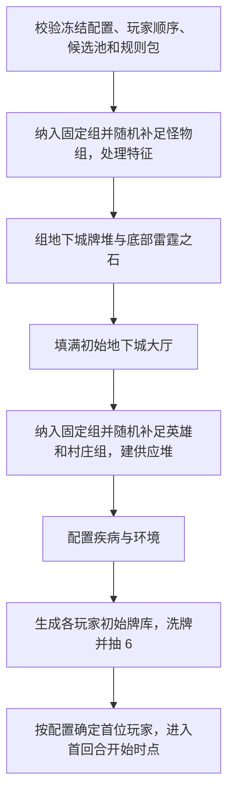

# 标准对局设置

`SETTING_UP` 把联机层提交的冻结规则配置与有序玩家列表转成可玩的 `GameState`。本文件以《飞龙尖塔》规则书第 2～4 页的经典竞争对局为基线；网页版允许修改默认组数和指定部分组，具体环境牌也可能覆盖设置步骤。启动请求与职责边界见[引擎边界](00-engine-boundary.md)，输入输出的数据约定见[卡牌目录与规则包](01-catalog-and-rulesets.md)和[状态模型](02-state-model.md)。

## 1. 设置请求与状态机

```text
FrozenSetupInput  # 由联机层提交，非引擎内的房间状态
  match_id, 有序 player_ids / seat_index
  ruleset_mode = classic
  content_set, catalog_version, ruleset_version
  village_groups = 8, hero_groups = 4, monster_groups = 3  # 可修改的默认值
  fixed_randomizer_ids_by_kind, fixed_feature_ids, fixed_environment_id?
  fill_policy_by_kind, thunderstone_selection
  first_player = random | fixed(player_id, source)
  rng_seed, rng_algorithm_version
```

这些是联机层给引擎的**不可变输入**，不是引擎自己管理的房间配置草稿或组局时由客户端临时提交的选择。引擎校验这些字段后开始设置。`content_set` 很重要：规则书说明只使用《飞龙尖塔》盒内牌时，怪物随机设置池只加入其中 3 张地下城特征牌；混合其他系列时可加入更多。模组包含多个扩展，不能把模组中的所有随机牌自动当作每一局必用候选。固定设置可以用来重现规则书的入门组合或调试某个卡牌效果，但必须记录实际选中的卡组。



以上步骤应由可记录的设置指令和随机事件完成。不得让客户端直接提交洗牌后的顺序；如果某个设置能力需要玩家选择，可在设置阶段生成 `PendingChoice`，完成后再继续。所有生成结果先属于组局尝试，完整通过校验后才发布为 `PLAYING` 的首个状态。

## 2. 抽怪物与地下城特征

1. 先把配置中指定的怪物组放入结果，占用怪物组名额；再从符合 `content_set` 且尚未选中的怪物随机设置牌池无放回抽取，直到取得配置要求的组数。默认目标是 **3 组**，但不能硬编码。抽取途中出现的地下城特征牌不计入怪物组数，仍保留并按其规则处理；指定的地城特征也进入待结算队列。
2. 从 `SetupCatalog` 取出最终各组的实际怪物牌实例。规则书说常见怪物组约 10 张；确切牌单和数量由逐组映射决定。洗混组成地下城主牌堆。
3. 对指定和随机得到的地下城特征按确定顺序逐项结算。陷阱或宝藏牌组洗入地下城牌堆；守护者按规则书先取主牌堆 10 张、与所选守护者洗混，再放回牌堆底部；环境/场景放在设置区且标准规则下至多生效 1 张。指定环境与随机环境相遇时，按已编译的“已有环境”设置能力处理，不能暗自保留两张。
4. 特征随机牌本身也有设置能力。例如 `TS-0201`“厄运成双”继续抽两张特征，`TS-0205`“环境”在已有环境时改为继续抽其他特征。实现上使用有边界的待处理特征队列，不用无限递归；抽取池耗尽时返回明确的设置错误或该规则约定的停止结果。

每次抽取都记录候选池版本、实际抽到的随机牌 ID，以及最终拿出的实际牌组；指定项记录来源为配置。这样既能重放，也能回答“为什么本局出现这组怪物”。设置后随机设置牌本身不进入地下城或玩家牌库。若固定组已经占满怪物名额，也要执行指定特征；不再无理由抽怪物随机牌。特征的随机出现策略由配置明确记录。

## 3. 雷霆之石与初始大厅

普通设置在地下城牌堆构建完成后，数出底部 10 张牌，将一张所选雷霆之石与这 10 张洗混，再放回牌堆底部。玩家可在开局前共同指定雷霆之石，也可随机选。场景或战役若要求多张石头，应由明确的设置规则覆盖这一操作；`TS-0199`“放逐仪式”还规定“末日之心”的位置和不同终局条件。

从牌堆顶翻出卡牌，填入大厅阶层 1、2、3；阶层 1 离牌堆最远。**开局填厅**若翻出陷阱或宝藏，将其移到牌堆底部并继续翻牌；开局已有阶层 1 怪物不触发突破。`HALL_FILLED_AT_SETUP` 与游戏中的 `HALL_REFILLED` 必须是不同事件，避免误触发陷阱或突破。设置数据需要保证最终能放满合法大厅；若牌堆内容不足，应在组局校验时拒绝，而不是不停翻牌。

## 4. 村庄、英雄和疾病供应

村庄始终包含 **民兵、火把、应急干粮、匕首**四种基础牌。按照本项目已确定的游戏目标，这四种基础牌在村庄中采用**无限供应**；为玩家生成初始牌组不会减少可购买数量。供应可以作为规则控制的逻辑牌堆，在有人购买时创建实例，不必在状态中预生成无限张牌。

先纳入指定的英雄、村庄组，再分别从符合内容集的随机设置池无放回抽取，补足配置目标；默认分别是 4 组、8 组。各组实际供应由 `SetupCatalog` 构建。英雄堆按低等级在上、高等级在下：通常 1 级 6 张、2 级 4 张、3 级 2 张；有两级或四级的特殊英雄时使用逐组定义。购买只能拿当前堆顶；升级可以按规则寻找下一等级牌。村庄牌供应同样需要逐组准确数量，不从 TTS 摆放快照直接推断。

疾病牌单独配置。普通疾病与特殊疾病为不同牌堆配置；若本局选中 `TS-0034`“腐化德鲁伊”、`TS-0035`“虫群”或 `TS-0147`“希德”，按其卡面切换到特殊疾病配置。多个触发只应形成**一次**有效配置，不重复替换或混入普通疾病。疾病数量按规则视为无限，摧毁后回到其供应，不进入普通摧毁区。

## 5. 玩家初始牌库

对每位玩家生成 6 张民兵、2 张匕首、2 张应急干粮、2 张火把，共 12 个独立 `instance_id`。分别洗混玩家抽牌堆并抽 6 张起始手牌；其余 6 张留在抽牌堆。玩家经验点从 0 开始，金币等回合资源为空。`first_player=random` 时引擎从提交的玩家中随机选择；`fixed` 时使用联机层解析出的本局 `player_id`，并检查它属于本局。上一局赢家和房主的身份由联机层解析，`source` 只作来源记录。此后沿已提交的座位顺序循环。初始手牌在选择村庄或地下城行动并展示前属于玩家私有信息。

`TDS_CN.json` 的 Lua 脚本把 12 张起始牌发到每名入座玩家区域，并提供手动抽牌/新回合按钮。网页引擎应完成规则书规定的洗牌与起始抽 6 张，不把 TTS 的手动操作步骤当作游戏规则。

## 6. 设置完成的验收

- 实际怪物、英雄、村庄组数等于冻结配置的目标值（默认 3、4、8），除非已编译的设置能力明确改变；地下城特征不计入怪物组数。
- 大厅阶层 1～3 各有合法初始卡；没有在设置期间结算陷阱、宝藏或突破。
- 普通雷霆之石位于地下城牌堆底部的 11 张组合中；特殊场景有自己的可验证位置约束。
- 每名玩家正好有 12 张初始牌，初始手牌 6 张；基本牌供应和疾病供应不因生成玩家牌库而耗尽。首位玩家与冻结策略一致，且属于本局参与者。
- 环境互斥、特殊疾病配置、已选牌组和所有随机结果写入设置记录；任何未编译卡牌在设置开始前已被挡下。
