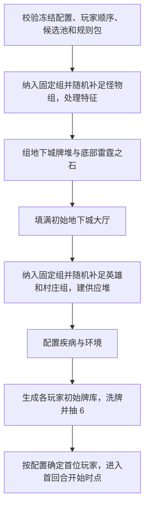

# 标准对局设置

`SETTING_UP` 把联机层提交的冻结规则配置与有序玩家列表转成可玩的 `GameState`。本文件以《飞龙尖塔》规则书第 2～4 页的经典竞争对局为基线；网页版允许修改默认组数和指定部分组，具体环境牌也可能覆盖设置步骤。启动请求与职责边界见[引擎边界](00-engine-boundary.md)，输入输出的数据约定见[卡牌目录与规则包](01-catalog-and-rulesets.md)和[状态模型](02-state-model.md)。

## 1. 设置请求与状态机

```text
FrozenSetupInput  # 由联机层提交，非引擎内的房间状态
  match_id, 有序 player_ids
  ruleset_mode = classic
  catalog_version, ruleset_version
  village_groups = 8, hero_groups = 4, monster_groups = 3  # 可修改的默认值
  fixed_randomizer_ids_by_kind
  dungeon_feature_mode = classic_random | manual
  extra_dungeon_cards = {
    guardian, environment: {random_count, fixed_card_ids},
    trap, treasure: {random_count, fixed_group_ids}
  }
  thunderstone_selection = {fixed_card_ids: []}
  instance_multipliers = {village: 1, hero: 1, monster: 1}
  first_player = random | fixed(player_id, source)
  rng_seed, rng_algorithm_version
```

这些是联机层给引擎的**不可变输入**，不是引擎自己管理的房间配置草稿或组局时由客户端临时提交的选择。引擎校验这些字段后开始设置。当前配置使用完整卡牌目录，不提供扩展筛选；固定设置可以用来重现规则书的入门组合或调试某个卡牌效果，必须记录实际选中的卡组。规则书只使用《飞龙尖塔》盒内牌时的特征牌限制属于另一个预设方案，暂不由此配置面板表达。



以上步骤应由可记录的设置指令和随机事件完成。不得让客户端直接提交洗牌后的顺序；如果某个设置能力需要玩家选择，可在设置阶段生成 `PendingChoice`，完成后再继续。所有生成结果先属于组局尝试，完整通过校验后才发布为 `PLAYING` 的首个状态。

## 2. 抽怪物与地下城特征

1. 先依据确定的环境修正组数：末日之门使怪物组 +1；绝境庇护所使村庄组 +2、英雄组 -1；飞龙尖塔将怪物组覆盖为 4，并分成两个各含 2 组怪物的地下城。环境随机时，抽出具体环境后再计算实际目标；若新的目标低于已选组数，则在已选组（包括原先固定的组）中随机丢弃超出的组，并记录每次丢弃。确定环境的配置仍需在提交前满足目标。`classic_random` 下地下城随机设置池由怪物组随机牌和“地下城特征”设置入口混合：先纳入固定怪物组，再从未选中的随机牌池抽取，直到达到实际目标。抽到 `TS-0018`“地下城特征”时按其效果转抽具体特征并继续；它不计入怪物组数。`manual` 下不加入特征入口，四类手动选择取代这一流程。怪物组卡按无放回处理，特征入口的重复副本按生成的随机牌池数量处理。
2. 根据[生成的 `SetupCatalog`](01-catalog-and-rulesets.md) 找到最终各怪物组的成员，从 `cards.csv.initial_copy_count` 读取每张牌默认数量，乘以本局 `instance_multipliers.monster` 后实例化。规则书说常见怪物组约 10 张，但最终张数由实际卡组和倍率决定。洗混组成地下城主牌堆。
3. `classic_random` 下对随机得到的地下城特征按确定顺序逐项结算；`manual` 下守护者和环境先纳入 `fixed_card_ids`，再从未固定的实际卡牌中无放回抽取 `random_count` 种；陷阱和宝藏先纳入 `fixed_group_ids`，再从未固定的完整牌组中无放回抽取 `random_count` 组。陷阱共有 3 组、宝藏共有 4 组，每组包含多张不同的实际卡牌，组 ID 使用对应特征牌 ID，但手动配置不将该特征牌本身加入游戏。两种方式互斥，均不占怪物组名额。每种实际卡牌使用 CSV 默认实例张数。陷阱或宝藏牌组洗入地下城牌堆；守护者按规则书先取主牌堆 10 张、与所选守护者洗混，再放回牌堆底部；环境/场景放在设置区且标准规则下至多生效 1 张。已加入环境时特征又抽到环境，按已编译的“已有环境”设置能力处理。
4. 特征随机牌本身也有设置能力。例如 `TS-0201`“厄运成双”继续抽两张特征，`TS-0205`“环境”在已有环境时改为继续抽其他特征。实现上使用有边界的待处理特征队列，不用无限递归；抽取池耗尽时返回明确的设置错误或该规则约定的停止结果。

每次抽取都记录候选池版本、实际抽到的随机牌 ID，以及最终拿出的实际牌组；额外固定项记录来源为配置，额外随机项记录来源为配置随机位。这样既能重放，也能回答“为什么本局出现这组怪物”。设置后随机设置牌本身不进入地下城或玩家牌库。若固定组已经占满怪物名额，不再无理由抽怪物随机牌；额外实际卡牌仍按配置加入。

## 3. 雷霆之石与初始大厅

普通设置在地下城牌堆构建完成后，数出底部 10 张牌，将一张所选雷霆之石与这 10 张洗混，再放回牌堆底部。玩家可在开局前固定所用雷霆之石，不足目标数的名额随机补足。`TS-0198`“飞龙尖塔”使用两个地下城牌堆，每个牌堆底部 5 张内各洗入一张雷霆之石，目标共 2 张；玩家在组局时决定地下城特征分配到哪一个牌堆。`TS-0199`“放逐仪式”强制选入全部 7 张雷霆之石并与怪物、陷阱、宝藏一起洗入地下城牌堆；其他所选守护者再按底部 10 张的规则加入，末日之心强制置底，启用卡面规定的取得与终局条件。

从牌堆顶向下寻找怪物牌，依次填入大厅阶层 1、2、3；阶层 1 离牌堆最远。**开局填厅**若翻出陷阱或宝藏，将其移到牌堆底部并继续翻牌；若遇到雷霆之石，则跳过并继续寻找怪物，填厅后让跳过的雷霆之石按原有顺序留在剩余牌堆顶部。放逐仪式也按此规则处理；按 2026-10-24 审核裁定，末日之心只在初始构建牌堆时置底，填厅或后续效果可以把其他牌送到它下面，不持续锁定最底位置。开局已有阶层 1 怪物不触发突破。`HALL_FILLED_AT_SETUP` 与游戏中的 `HALL_REFILLED` 必须是不同事件，避免误触发陷阱或突破。设置数据需要保证最终能放满合法大厅；若牌堆内容不足，应在组局校验时拒绝，而不是不停翻牌。

## 4. 村庄、英雄和疾病供应

村庄始终包含 **民兵、火把、应急干粮、匕首**四种基础牌。按照本项目已确定的游戏目标，这四种基础牌在村庄中采用**无限供应**；为玩家生成初始牌组不会减少可购买数量。供应可以作为规则控制的逻辑牌堆，在有人购买时创建实例，不必在状态中预生成无限张牌。

先纳入指定的英雄、村庄组，再分别从随机设置池无放回抽取，补足配置目标；默认分别是 4 组、8 组。各组成员按 CSV 的英雄系列和村庄名称匹配，少量别名来自例外表。每张成员牌的默认张数取自 `cards.csv.initial_copy_count`，分别乘以本局 `instance_multipliers.hero` 或 `instance_multipliers.village`。所有等级英雄共用英雄倍率；英雄堆按低等级在上、高等级在下，通常默认是 1 级 6 张、2 级 4 张、3 级 2 张，特殊英雄按 CSV 默认数量乘倍率建堆。购买只能拿当前堆顶；升级可以按规则寻找下一等级牌。

村庄盗贼（随机牌 `TS-0081`）占一个村庄组，在 `village_supply:TS-0081` 中形成一个按等级排列的牌堆，上层 5 张村庄扒手（1 级），下层 3 张村庄强盗（2 级）。默认数量来自 CSV，适用**村庄倍率**；不拆成两个供应堆，也不占英雄组名额。英雄身份由“英雄”标签决定，设置索引的成员关系同时用于升级系列判定。普通村庄单卡供应仍使用 `village_supply:<card_id>`。

环境“风暴要塞”在供应建成时摧毁每个非基础村庄牌堆顶部的 2 张；基础牌仍按无限供应处理。环境“哀水沼泽”使初始大厅改为 4 个阶层。其余环境在回合中生效的能力交由后续能力运行时处理。

疾病牌单独配置。若本局选中 `TS-0034`“腐化德鲁伊”、`TS-0035`“虫群”或 `TS-0148`“希德”，按其卡面切换到特殊疾病配置；否则使用普通疾病。多个触发只形成**一次**有效配置，不重复替换或混入普通疾病。普通配置只有 `TS-0714`；特殊配置包含 `TS-0715`～`TS-0720`。疾病供应是逻辑供应，不在组局时生成实体牌堆。每次取得疾病才创建一个新实例，按 `cards.csv.initial_copy_count` 作为相对权重独立抽取：普通疾病恒为 `TS-0714`，特殊疾病六种牌的权重为 `10:3:3:3:3:3`。这些数字只决定概率，不限制供应数量；摧毁疾病时从玩家区域移除实例，不进入普通摧毁区。

## 5. 玩家初始牌库

对每位玩家生成 6 张民兵、2 张匕首、2 张应急干粮、2 张火把，共 12 个独立 `instance_id`。分别洗混玩家抽牌堆并抽 6 张起始手牌；其余 6 张留在抽牌堆。玩家经验点从 0 开始，金币等回合资源为空。`first_player=random` 时引擎从提交的玩家中随机选择；`fixed` 时使用联机层解析出的本局 `player_id`，并检查它属于本局。上一局赢家和房主的身份由联机层解析，`source` 只作来源记录。此后沿已提交的玩家列表顺序循环。初始手牌在选择村庄或地下城行动并展示前属于玩家私有信息。

`TDS_CN.json` 的 Lua 脚本把 12 张起始牌发到每名入座玩家区域，并提供手动抽牌/新回合按钮。网页引擎应完成规则书规定的洗牌与起始抽 6 张，不把 TTS 的手动操作步骤当作游戏规则。

## 6. 设置完成的验收

- 实际怪物、英雄、村庄组数等于冻结配置的目标值（默认 3、4、8），除非已编译的设置能力明确改变；地下城特征不计入怪物组数。三类适用牌的实例数等于 CSV 的 `initial_copy_count` 乘本局类别倍率，其他牌保持默认数量，并保留来源。
- 大厅阶层 1～3 各有合法初始卡；没有在设置期间结算陷阱、宝藏或突破。
- 普通雷霆之石位于地下城牌堆底部的 11 张组合中；特殊场景有自己的可验证位置约束。
- 每名玩家正好有 12 张初始牌，初始手牌 6 张；基本牌供应和疾病供应不因生成玩家牌库而耗尽。首位玩家与冻结策略一致，且属于本局参与者。
- 环境互斥、特殊疾病配置、已选牌组和所有随机结果写入设置记录；任何未编译卡牌在设置开始前已被挡下。

## 7. 当前实现接口

`backend.app.integrations.game_engine.setup.start_game(request)` 接收 `match_id`、按回合顺序排列的 `player_ids`、`rng_seed` 和房间的 `config`，返回完整初始 `state` 与供服务器保存的设置 `events`。随机流使用固定版本的 SHA-256 计数器，同一目录、输入和种子生成相同结果；状态保存种子、算法版本和计数器。正式房间开局调用这一接口；原 `POST /api/v1/setup` 本地预览地址已不再挂载。`backend/scripts/sandbox/run_setup.py` 保留一次性命令行入口。

`backend.app.integrations.game_engine.disease.take_disease(state, player_id, destination="discard")` 从本局无限疾病供应取一张牌，返回新 `state`、新实例与事件。函数使用状态内保存的权重和随机计数器，每次调用都分配新的 `instance_id`，默认加入该玩家弃牌堆；原状态保持不变。调用方须将返回的状态和事件作为同一次状态转换保存。它是供后续能力运行时调用的内核接口，不向客户端开放指定疾病种类的参数。

飞龙尖塔的两个怪物组分配和地下城特征分配由玩家决定。首次调用若缺少 `scenario_choices.two_dungeons`，抛出 `SetupChoiceRequired`，其中列出本次随机选中的可分配组；面板会显示分配控件，联机层将来可使用相同协议。选择后用相同输入和种子附上 `group_a_ids`（恰好两个）及 `group_a_feature_ids` 重新调用，剩余项分配给另一座地下城。在选择完成前不发布初始状态。

Setup 返回首回合开始前的状态和设置事件，后续由 TypeScript 回合指令与效果运行时继续推进。设置期间直接影响牌区的环境和特殊疾病规则在这里执行；环境的持续与回合效果由运行时按登记的生效设置应用。
