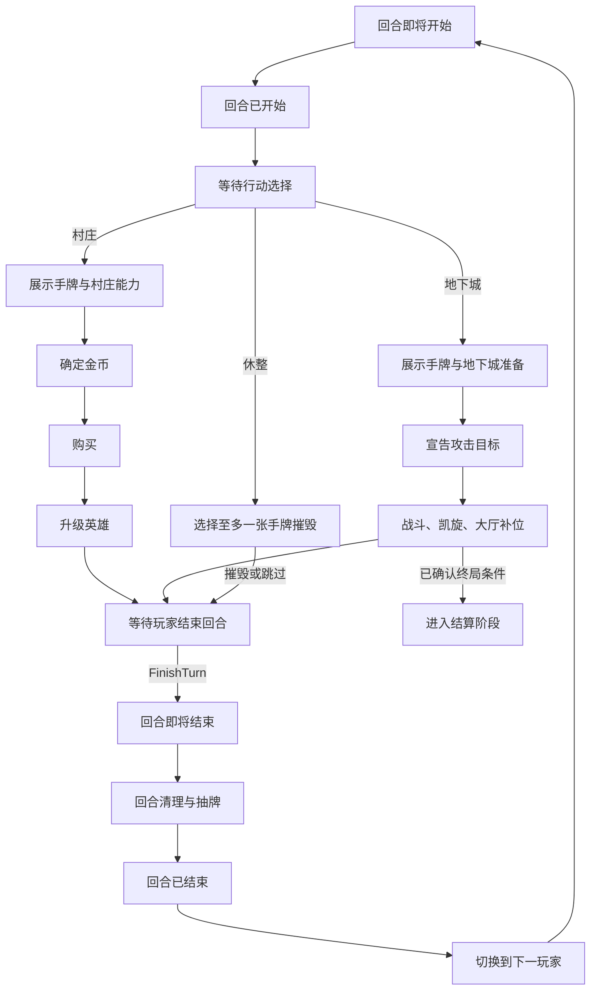

# 回合与三种行动

`PLAYING` 阶段从引擎设置时选出的首位玩家开始，随后按联机层提交的固定玩家列表顺序轮转，交接见[引擎边界](00-engine-boundary.md)。规则书第 5 页及第 24 页规定：玩家每回合必须选择**访问村庄、进入地下城、休整**中的一种，随后按该行动列出的步骤顺序执行。状态和区域见[状态模型](02-state-model.md)；地下城内部结算详见[地下城与战斗](05-dungeon-and-combat.md)。

当前 [TypeScript 回合内核](../../engine/src/turn/commands.ts)已实现三种行动的指令转换，以及完整的卡牌效果、特殊场景与终局计分。没有额外卡牌效果的步骤自动越过，但仍产生回合与行动边界事件；[已审核能力](ability-runtime-implementation.md)在对应窗口运行，并可暂停等待选择。Python 后端通过[适配层](../../backend/app/integrations/game_engine/README.md)提交指令，具体格式见[接口说明](../../backend/app/integrations/game_engine/README.md)。

## 1. 回合状态机

图中展示行动步骤；展示手牌、生产金币等自动步骤可以在一次命令内完成，等待操作或效果选择时才停留。阶段内部若需要玩家选目标、支付费用或决定发动顺序，产生 `PendingChoice` 并保存继续帧。只有当前阶段允许的指令能进入 `apply_command`。卡牌可以授予额外购买、重复能力或替代行动，但须用已编译规则显式改变合法行动集。任一阶段实际满足终局条件时，经本次事件结算确认后直接进入 `SETTLING`，不强行跑完图中的普通回合尾部。

### 回合边界事件

| 时点事件 | 发生位置 | 可用于什么 |
| --- | --- | --- |
| `TURN_WILL_START` | 已选定本回合玩家，尚未开放行动选择 | 回合开始前的强制/持续效果及替代规则 |
| `TURN_STARTED` | 开始前效果处理完毕 | 回合开始时效果；结算后才开放 `ChooseAction` |
| `ACTION_WILL_ENTER` / `ACTION_ENTERED` | 玩家选定村庄、地下城或休整之后、各自第一步之前 | 按行动类型触发或替代入口；手牌展示须按行动规则执行 |
| `ACTION_WILL_EXIT` / `ACTION_EXITED` | 所选行动的步骤及其效果全部处理完毕 | 行动结束类能力；不能提前清除手牌和回合资源 |
| `TURN_WILL_END` | 行动结束后、清理前 | 回合结束前效果及回合末延迟摧毁 |
| `TURN_ENDED` | 清理与下一手牌抽取后、切换玩家前 | 回合结束后效果；此时行动已结束但当前玩家仍指向本回合玩家 |

这些名称是**引擎时点约定**，不是把每张卡的“回合开始/结束”文本直接机械映射到同名事件。编译具体能力时须明确它在边界前还是后、作用于旧手牌还是新手牌，以及相同时点的优先级。每个时点事件先处理替代/阻止，再处理强制和可选触发，直至当前结算帧完成；若等待选择，时点与当前玩家都冻结。没有适用效果的时点自动前进，不额外等待玩家确认。

## 2. 展示与能力使用

访问村庄或进入地下城时，先展示当前手牌。展示改变可见性，不把卡牌从“手牌”语义中移除。休整不要求展示整手牌；玩家选择摧毁的那张牌及其结果依规则公开。

玩家可按所处地点决定可选能力的使用顺序；强制效果必须结算。普通能力按 `(instance_id, ability_id, turn_number)` 记录使用次数，本回合最多一次；“重复：村庄”或“重复：地下城”每次发动都重新校验费用和目标。离开有效区域或被摧毁的牌不能再发动能力。能力可能抽牌；本行动中新增的手牌仍需纳入当前状态，再依其展示和能力规则处理，不能把行动开始时的 6 张牌当成固定不变的集合。

## 3. 访问村庄

村庄行动严格按下表推进（规则书第 5、7～9、24 页）：

| 子阶段 | 输入与合法操作 | 完成条件及结果 |
| --- | --- | --- |
| `VILLAGE_ABILITIES` | 执行强制效果；玩家依次选择可用的村庄能力或结束能力阶段 | 牌若在能力阶段被弃置/摧毁，此后不贡献金币或能力；新增牌依其位置和展示规则处理 |
| `VILLAGE_GOLD` | 引擎合计**仍在场的已展示卡牌**金币值及此前能力产生的金币 | 固定本次可花费金币；不要使用行动开始时的旧快照 |
| `VILLAGE_BUY` | 默认一次购买，从非空供应堆的顶部选牌，核验费用 | 获得牌进弃牌堆；卡牌授予额外购买时仍共用本次金币预算；未花完的金币在行动结束时失去 |
| `VILLAGE_UPGRADE` | 玩家可继续升级合格的手牌英雄，也可结束升级 | 按原英雄的 `upgrade_xp_cost` 支付跨回合经验点、摧毁原英雄、从对应供应取目标英雄牌放入弃牌堆 |

购买先于升级。英雄即使已经在金币阶段贡献了印刷金币，也可以在之后的升级阶段被摧毁。购买必须取英雄或其他供应堆当前可购买的堆顶；升级可以依等级在已选的对应英雄系列堆中查找下一等级，不把“升级”误实现为普通堆顶购买。缺少目标等级、库存或经验点时，不提供该升级操作。

带“民兵”及“英雄”标签的 0 级牌可升为本局供应中任一有库存的 1 级英雄，包括村庄供应中的村庄扒手。费用取原牌的 `upgrade_xp_cost`：民兵为 3 点，精锐民兵为 2 点。目标必须实际存在于本局的英雄或村庄供应中，不包含未入局、缺货、0 级或 2 级以上的英雄。

其他英雄按设置索引中的随机牌组确定系列，只能升至同系列下一等级。村庄扒手支付 4 点经验可升级为同一“村庄盗贼”供应中的村庄强盗；升级可从牌堆下层取牌，无须先买完扒手。英雄身份按“英雄”标签判断，供应位置不改变其身份。普通英雄不能跳级，也不能让同一张牌在同一回合连续升两级；返回手牌的效果升级同样遵守这一限制。

金币用可解释的账本记录：展示牌金币、能力产生金币、每次购买支出。默认购买次数为 1，能力可以增加次数；多次购买的总支出不得超过本次总金币。回合末清零金币；经验点只有在规则实际支付时减少。

## 4. 休整

休整分为“摧毁手牌”和“结束回合”两个阶段。第一阶段为 `REST`，玩家可提交 `RestDestroy` 摧毁至多一张当前手牌，或提交 `SkipRestDestroy` 跳过；两者都进入共同的 `ACTION_END`，不弃牌、不补牌、不切换玩家。第二阶段只允许 `FinishTurn`，由玩家确认后进入统一回合清理。`players[player_id].rest_destroyed_on_turn` 记录本次使用的回合编号；离开第一阶段后不能再次摧毁，也不能返回摧毁阶段。普通牌进入摧毁区，疾病返回疾病供应。休整没有村庄购买、英雄升级和地下城战斗窗口；有明确“休整时”触发的环境或卡牌规则仍按事件处理。摧毁动作、卡牌及所属玩家为公开信息。

## 5. 进入地下城

玩家展示全部手牌，结算强制效果，可选择地下城能力和装备，再必须选取大厅中的一个合法攻击目标，即使预计攻击不足。装备、战斗效果、凯旋、补厅、陷阱和突破的具体阶段见[地下城与战斗](05-dungeon-and-combat.md)。如果效果让对局在行动中立即结束，转入 `SETTLING`，不再执行普通的回合末抽牌；终局计分仍包括玩家此时控制的手牌和其他牌。

## 6. 统一回合清理与抽牌

三种行动均停在持久化的 `ACTION_END`：村庄完成 `FinishUpgrading` 后进入；地下城完成战斗效果、战利品、延迟到战后的摧毁、归还及大厅补位后进入；休整摧毁或跳过后进入。此时保留手牌、回合资源及尚未到期的回合效果，刷新或重连不会自动结束。只有当前玩家提交 `FinishTurn` 才发出行动退出事件，进入 `TURN_WILL_END`，结算应在清理前发生的效果，包括战斗中被标记“回合末摧毁”的英雄，每个实体只处理一次。然后将剩余手牌，无论能力是否使用，放入当前玩家弃牌堆，清除本回合能力使用记录与临时资源，抽 6 张形成下一手牌。完成 `TURN_ENDED` 时点后才沿玩家列表顺序切换到下一玩家，并发出其 `TURN_WILL_START`。实际卡牌可能改变某一步时机；应由事件规则覆盖并记录。若已经触发终局则直接结算；被淘汰的玩家自动交接，不等待其提交指令。

任何效果需要从玩家个人抽牌堆取牌时，都共用按需重洗规则，包括抽进手牌、展示、翻牌和弃牌检定。抽 `n` 张的原子操作：

1. 从当前抽牌堆顶取尽可取的牌，直到已抽 `n` 张或抽牌堆空。
2. 只有仍需抽牌且抽牌堆已空时，才洗混该玩家的**全部**弃牌堆，作为新的抽牌堆，然后继续。
3. 两处都无牌时停止，返回实际抽到的数量；不得生成不存在的卡牌，也不得因空牌堆进入循环。

### 持续翻牌检定

海德拉、酒馆殴斗、滚石陷阱和龙之颚共用以下终止约定：

- 以玩家和实例 ID 记录本次效果中检定过但未能推进目标的牌；同名不同实例分别记录。
- 抽牌堆空时照常洗混弃牌堆继续；非目标牌处理后立即弃置，之后可能再次参与检定。
- 洗牌和成功处理均保留已有的无进展记录。已记录的牌仍按正常顺序处理，不因记录而跳过玩家或牌。
- 若某实例的有效卡牌、持有者或实例状态变化，只使该实例原有的无进展记录失效；新进入取牌范围的实例也需要检定。
- 每轮结束后，所有相关玩家当前抽牌堆与弃牌堆中的实例都已有有效的无进展记录时，结束检定，保留已完成的结果；达到卡文目标则立即结束。
- 海德拉和酒馆殴斗对单个受影响玩家寻找第一名英雄；滚石陷阱、龙之颚对全部实际受影响玩家共同判定能否继续，并保持逆时针轮流检定。

用户确认：滚石陷阱、龙之颚中的摧毁被替代为弃牌时，仍计入一次目标进展。该实例不因此加入无进展记录；若它之后被洗回并再次检定到，照常处理。其成功处理不清空其他牌的记录。

手牌、控制区、其他人的牌、暂存翻牌区和供应堆按各自规则放置，仅实际属于该玩家抽牌堆或弃牌堆的牌参与重洗。有限张数的翻牌保留其批量展示区，处理后再处置剩余牌；本目录其余 19 条固定数量的玩家翻牌能力也使用相同的按需重洗入口。假酒保补足手牌至 6 张通过普通抽牌入口完成。

网页规则简化：玩家在自己的回合中，无论访问村庄、进入地下城还是休整，整手牌始终公开；回合内新抽取或获得进手牌的牌同样公开。开局确定首位玩家、此后交接到下一玩家时，引擎立即设置 `turn_hand_public = true`，无需等待行动选择。回合末弃牌补牌开始前设置为 `false`；即使补牌的获得／替代效果暂停，此时的新手牌仍隐藏，直到下次自己的回合开始。期间被效果单独展示的卡牌按实例标记公开，离开手牌、再次被抽取后清除该次标记。规则中的“展示手牌”阶段及原编号保留，自动完成，不增加额外点击；其他玩家通过列表气泡看到展示提示。

若对局在清理前满足终局条件，清理和抽牌不会再改变牌的归属或计分。若 `TURN_ENDED` 等后续边界效果触发终局，须在切换下一玩家前停下并记录触发来源。

## 7. 阶段合法性检查

| 指令意图 | 有效窗口 | 主要前置条件 |
| --- | --- | --- |
| `ChooseAction` | 等待行动选择 | 当前玩家、三种基本行动之一 |
| `ActivateAbility` | 对应村庄/地下城或明确触发窗口 | 来源牌在有效区域、未超过次数、费用可支付 |
| `BuyCard` | 村庄购买 | 供应可购、次数充足、金币足够 |
| `UpgradeHero` | 村庄升级 | 原英雄仍在手牌、目标同系列下一等级、经验与库存充足 |
| `RestDestroy` / `SkipRestDestroy` | 休整第一阶段 | 摧毁至多一张当前手牌，或跳过，然后进入 `ACTION_END` |
| `FinishTurn` | `ACTION_END` | 当前玩家确认结束，三种行动共用同一清理流程 |
| `DeclareBattleTarget` | 地下城准备完成后 | 目标在可攻击大厅阶层，满足禁止攻击的限制 |
| `SubmitBattleTeam` | 地下城准备完成后 | 当前版本的队伍草稿；英雄、支援与武器来自手牌，装备合法且目标可攻击 |
| `ResolveChoice` | 有待选择项时 | 指令来自指定选择者，选项是当前候选的一部分 |

前端只发送意图和实例 ID，不发送金币合计、攻击值或抽牌结果。新客户端使用 [`SubmitBattleTeam`](battle-team-api.md)提交战斗队伍；`DeclareBattleTarget` 保留用于旧回放兼容。
